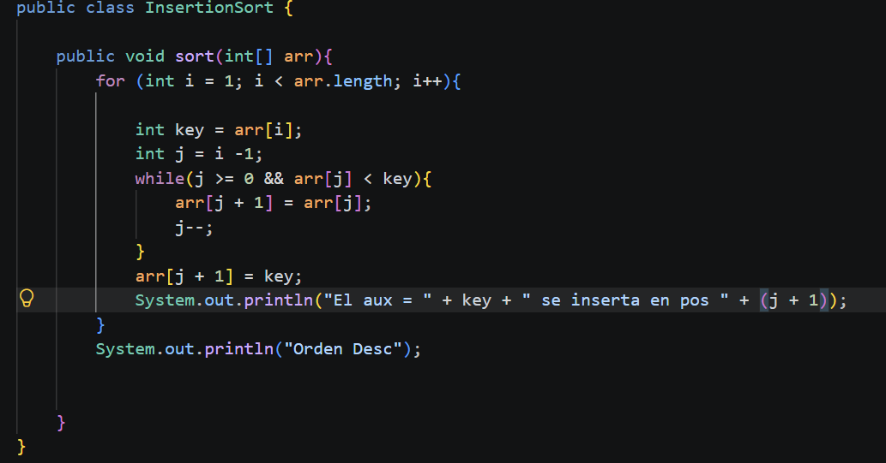
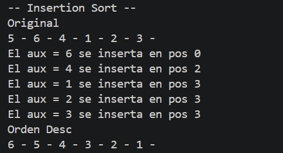

# PC 1.1.3 

Metodo de insercion 

Resultado

### Explicacion

Recorre el arreglo tomando un elemento a la vez y lo compara con los anteriores para ubicarlo en la posicion correcta logrando un orden descendente (arr[j] < key)

